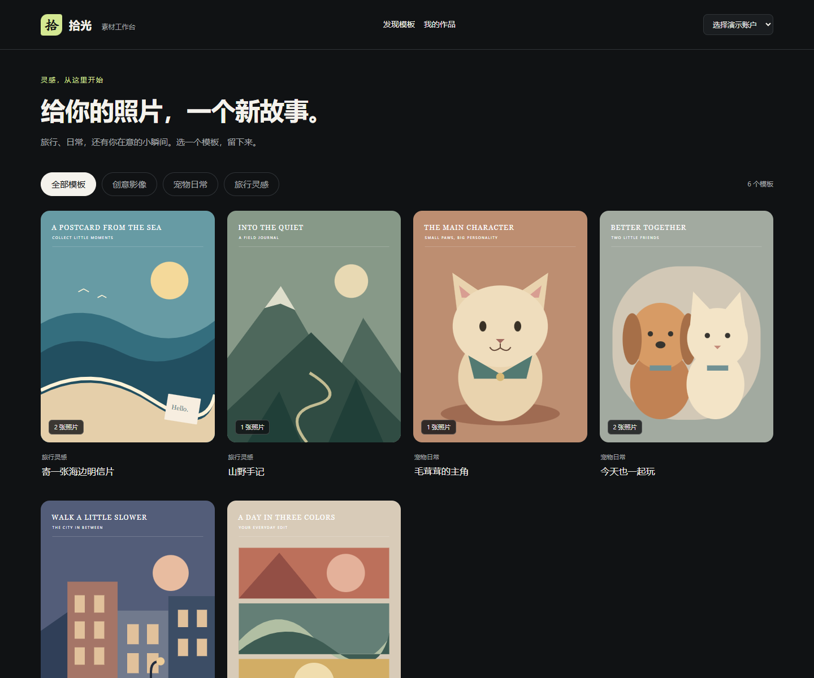
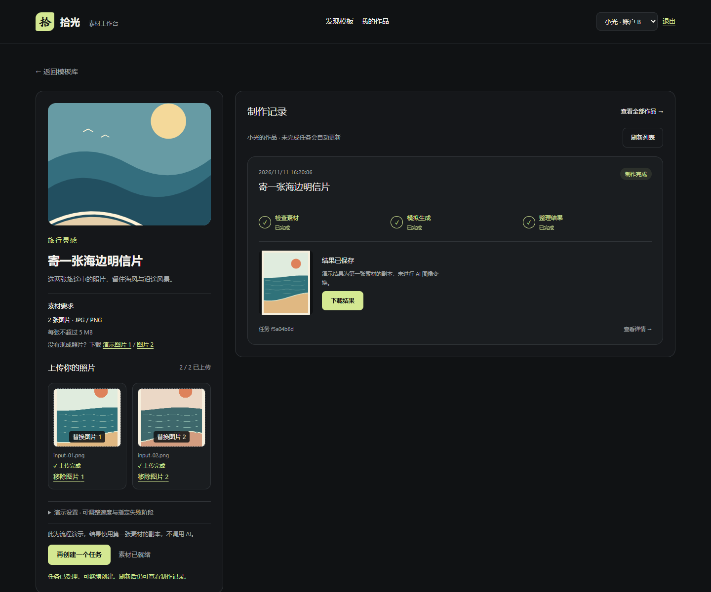
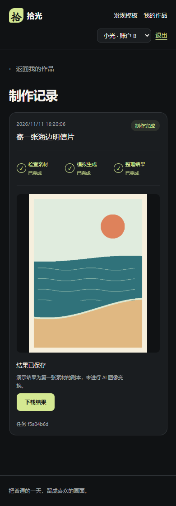

# 五分钟验收演示

## 启动

```sh
docker compose up --build --wait
```

打开 http://localhost:3000。无需第三方账号、API Key 或付费服务。第一次构建需要下载官方镜像和依赖。选用任意 JPEG/PNG，也可使用仓库自带的 `frontend/public/demo/input-01.png` 和 `input-02.png`；详情页提供下载链接。

## 1. 模板和上传（约一分钟）

1. 切换首页分类，打开「寄一张海边明信片」，确认要求 2 张图片。
2. 选择「小拾 · 账户 A」。上传第一张图片，此时「开始制作」仍不可用；上传第二张后才可提交。
3. 点击已有图片替换，或点「移除图片」；选择非 JPG/PNG 或超过 5 MB 的文件会显示具体错误。
4. 开发者工具使用 Slow 3G 可观察上传状态；上传中替换/移除图片会取消旧请求。

## 2. 成功、耗时和多任务（约一分钟）

1. 展开「演示设置」，选择「标准 · 2.5 秒」，结果选「全部成功」。
2. 点击「开始制作」，请求受理后按钮恢复，右侧记录显示排队或制作中。
3. 再创建一个任务。每张任务卡分别显示素材检查、模拟生成、结果整理。
4. 等待完成后预览结果。结果是第一张素材的独立副本；没有真实 AI 变换。

## 3. 确定性失败（约一分钟）

分别选择「检查素材失败」「模拟生成失败」「整理结果失败」，每次新建任务；也可只选其中一个阶段快速验收。失败卡显示阶段和原因，后续步骤显示「未执行」。另建成功任务不会继承失败任务的错误。

## 4. 查询异常与刷新（约一分钟）

1. 创建每阶段 8 秒的任务，受理后用浏览器开发者工具临时阻断 `/api/tasks/{id}` 查询，或切换 Offline。
2. 已有任务信息保留，页面提示「进度查询暂时失败」，不会把任务改为执行失败。
3. 恢复网络，点「重新查询」或等待自动重试。后台任务继续运行。
4. 打开「我的作品」并刷新，仍能恢复任务和结果；未完成任务继续跟踪。也可关闭页面稍后重开。

## 5. 用户隔离（约一分钟）

选择「小光 · 账户 B」后，上传位和任务列表切换到 B 的记录；不能读取 A 的任务链接。切回 A 后可恢复 A 的历史。点击「退出」，个人接口返回 401。

## 自动化验证

后端：`python scripts/backend_smoke.py --restart`。前端：在 frontend 目录执行 `pnpm test`，以及在服务运行时执行 `pnpm test:e2e`。首次浏览器测试先执行 `pnpm exec playwright install chromium`（Linux CI 使用 `--with-deps`）。Windows 已安装 Chrome 时可设置 `PLAYWRIGHT_CHANNEL=chrome`。

浏览器测试使用真实 Java/MySQL；只在指定测试里注入查询网络失败或延迟上传，验证异常恢复和旧请求清理。截图生成：`node scripts/capture-demo.mjs`，会创建少量真实演示记录。

## 实际界面






